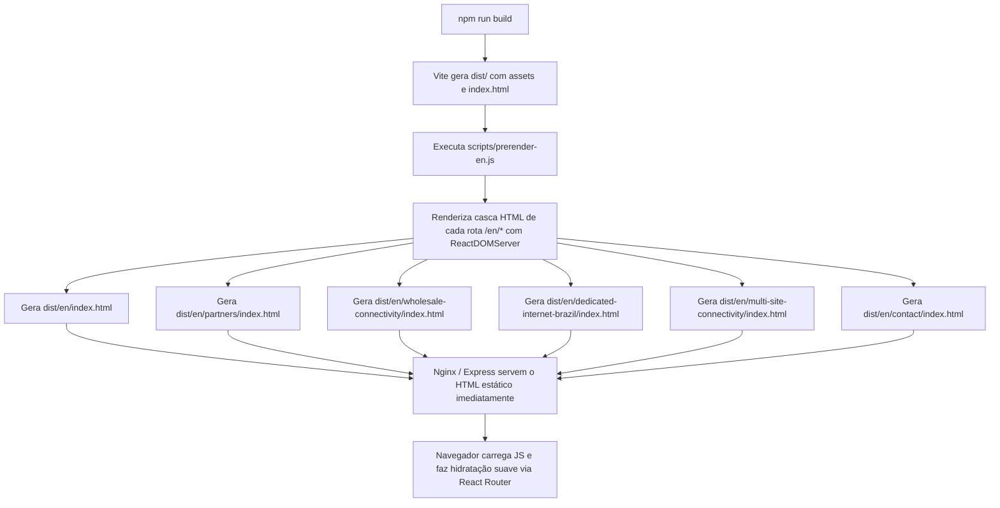

# Nuvv Global Partners — Arquitetura de Software e Infraestrutura (Fase 1)

> **Documento:** GLOBAL_PARTNERS_ARCHITECTURE.md  
> **Projeto:** Nuvv Global Partners — "Your Local Connectivity Partner in Brazil"  
> **Data:** 27 de Outubro de 2026  
> **Autor:** Equipe de Arquitetura de Software & Engenharia Web  
> **Status:** Concluído / Fase 1 (Arquitetura e Engenharia)

---

## 1. Visão Geral da Arquitetura Proposta

A expansão internacional da Nuvv foi projetada para cumprir rigorosamente o princípio de **mínima complexidade com máxima eficácia técnica e de SEO**.

### Premissas Centrais:
- **Zero Impacto no Site Brasileiro:** Nenhuma rota, componente ou regra de negócio em português será modificada ou colocada em risco.
- **Zero Custo Adicional de Infraestrutura:** Aproveita 100% da stack existente (Node.js/Express, PM2, Nginx, SQLite e VPS).
- **Sem Migração de Framework:** Mantém o projeto em Vite + React 19 + React Router v7, evitando o custo e os riscos de uma migração completa para Next.js.
- **Indexabilidade Instantânea:** Entrega de HTML pré-renderizado no momento do build (SSG pragmático) para as páginas `/en/*`, resolvendo o gargalo de motores de busca como o Bing e rastreadores B2B.

---

## 2. Estrutura de Rotas e Hierarquia de Informação

Para evitar **canibalização de palavras-chave** e **páginas com conteúdo excessivamente fino (*thin content*)**, estruturamos uma hierarquia semântica enxuta e focada em intenção de busca corporativa B2B.

### 2.1. Mapa de Rotas Recomendado

```
/ (pt-BR - Raiz do ecossistema nacional)
│
└── /en/                                 [Página Pilar Principal]
    │                                    Posicionamento: "Your Local Connectivity Partner in Brazil"
    │                                    Público: MSPs, Integradores, Carriers Globais
    │
    ├── /en/partners/                    [Pilar de Parcerias e Modelos de Canal]
    │                                    Foco: Como operamos com MSPs, Carriers e Brokers (NNI, White-label)
    │
    ├── /en/wholesale-connectivity/      [Pilar de Conectividade de Atacado & Last Mile]
    │                                    Foco: Local Loop, Last Mile Fiber, E-Line / P2P, Metro Ethernet
    │
    ├── /en/dedicated-internet-brazil/   [Pilar de DIA / Acesso Dedicado]
    │                                    Foco: Dedicated Internet Access (DIA) 1:1, BGP Peering, SLA 4h, IX.br
    │
    ├── /en/multi-site-connectivity/     [Pilar de Redes Corporativas / SD-WAN Underlay]
    │                                    Foco: Interligação de filiais, underlay de alta disponibilidade no Brasil
    │
    └── /en/contact/                     [Página de Ação e Cotação / RFQ]
                                         Foco: Solicitação de viabilidade e cotação de circuitos para parceiros
```

### 2.2. Justificativa das Decisões de Roteamento

1. **Fusão de "Local Loop" e "Last Mile":**
   - *Proposta inicial do usuário:* Criar `/en/brazil-local-loop/` e `/en/last-mile-connectivity/`.
   - *Análise arquitetural e semântica:* No vocabulário técnico de telecomunicações, *Local Loop* e *Last Mile* possuem a mesma intenção comercial para um Carrier ou MSP estrangeiro (necessidade de conectar o cliente final até o PTT/PoP mais próximo). Separar em duas páginas geraria sobreposição de 80% do vocabulário técnico e risco de canibalização nos rankings.
   - *Solução:* Centralizar em `/en/wholesale-connectivity/` com seções aprofundadas e títulos H2 dedicados a *Brazil Local Loop Services* e *Carrier-Grade Last Mile Fiber*, garantindo um documento de alta relevância técnica e autoridade unificada.
2. **Rota Específica para DIA (`/en/dedicated-internet-brazil/`):**
   - Possui intenção de busca técnica muito diferente de redes privadas/atacado. O comprador de DIA busca garantias de trânsito IP, peering com o IX.br (São Paulo), blocos de IPv4/IPv6 alocados e SLA de latência/perda de pacotes.

---

## 3. Estratégia de Internacionalização (i18n)

### 3.1. Não Utilização de Bibliotecas Pesadas de Runtime
Muitos projetos implementam `react-i18next` de forma genérica, carregando JSONs de tradução via HTTP que degradam o First Contentful Paint (FCP) e aumentam o tamanho do bundle.

### 3.2. Abordagem Recomendada: Componentes Nativos em Inglês
Para o escopo de 6 páginas internacionais voltadas a tomadores de decisão corporativos:
- Criação de componentes dedicados dentro de `src/pages/en/`.
- Textos técnicos e comerciais em inglês americano diretamente nos componentes e em arquivos de dados estruturados em `src/data/en/`.
- Benefícios:
  - Zero dependências adicionais no `package.json`.
  - Zero complexidade de chaves de tradução quebradas ou fallbacks faltantes.
  - Otimização de árvore de dependências (Tree-shaking) e Lazy Loading por rota.

### 3.3. Layouts Isolados (`GlobalLayout`)
O ecossistema `/en/*` utilizará um layout dedicado:
- **`GlobalHeader.tsx`:**
  - Logotipo Nuvv institucional.
  - Navegação internacional limpa: *Solutions* (Wholesale, DIA, Multi-site), *Partner Program*, *Why Nuvv Brazil*, *Request a Quote (CTA)*.
  - Seletor discreto de idioma com opção para retornar ao site brasileiro (`PT | EN`).
  - **Eliminação completa** do seletor de cidades do Brasil, 2ª via de fatura, SAC residencial e planos de TV/Streaming, que causariam ruído e confusão para um parceiro estrangeiro.
- **`GlobalFooter.tsx`:**
  - Informações corporativas, compliance, dados de NOC 24/7/365, presença nos principais data centers e IX.br, e links úteis em inglês.

---

## 4. Abordagem de Renderização e SEO (SSG Pragmático no Vite)

Esta é a decisão de engenharia mais crítica do projeto.

### 4.1. O Desafio
O Vite por padrão gera um único `dist/index.html`. Em um servidor Express, qualquer rota desconhecida faz fallback para esse arquivo. Para o Googlebot, o JavaScript executa, mas para o **Bingbot, LinkedIn, WhatsApp e ferramentas corporativas**, a página aparece como a home brasileira em português.

### 4.2. A Solução: Script de Pré-Renderização Estática no Build (`scripts/prerender-en.js`)
Sem alterar a forma como o React roda no cliente, adicionamos uma etapa pós-build que gera os arquivos HTML estáticos correspondentes a cada rota `/en/*`:



### 4.3. Por que Esta Solução é Superior?
1. **HTML 100% Legível Imediatamente:** O Bingbot e o Googlebot recebem no primeiro milissegundo:
   - `<html lang="en">`
   - `<title>` em inglês corporativo.
   - `<meta name="description">` em inglês.
   - Tags Open Graph e Twitter Cards em inglês.
   - JSON-LD Schema.org em inglês.
   - Estrutura completa de `<h1>`, `<h2>`, `<p>` e listas de argumentos comerciais.
2. **Hidratação Transparente:** Quando o visitante humano acessa a página, o React Router entra em ação e permite navegação instantânea de SPA sem recarregamento de página.
3. **Custo Computacional Zero:** Não há servidor Node.js fazendo renderização pesada sob demanda (SSR). Os arquivos são estáticos e servidos direto da memória/disco pelo Nginx.

---

## 5. Arquitetura de Captação e Integrações Futuras

### 5.1. Formulário Internacional de Cotação (RFQ / Partner Inquiry)
Na rota `/en/contact/` e em modais de cotação das páginas internas:
- **Campos Estruturados:**
  - Company Name (Empresa parceira)
  - Partner Type (MSP, Global SI, Carrier, Telecom Broker, Enterprise End-User)
  - Contact Name & Business Email
  - Country of Origin / Headquarters
  - Client / Opportunity Location in Brazil (City, State, or CEP/Address if known)
  - Required Service (Dedicated Internet, Local Loop / Last Mile, Multi-site SD-WAN Underlay, Colocation)
  - Required Bandwidth (100 Mbps to 10 Gbps)
  - Target Delivery Date / Project Timeline
  - Technical Notes / RFC details
- **Backend:**
  - Utilização do endpoint já existente `POST /api/commercial-leads` com `source_page: '/en/...'`.
  - Tratamento para que o campo CNPJ não seja obrigatório para entidades estrangeiras (armazenando Tax ID / Registration no campo `details`).
  - Disparo de e-mail prioritário via `server/smtp.js` para o time internacional/wholesale da Nuvv com a tag `[GLOBAL PARTNER RFQ]`.
